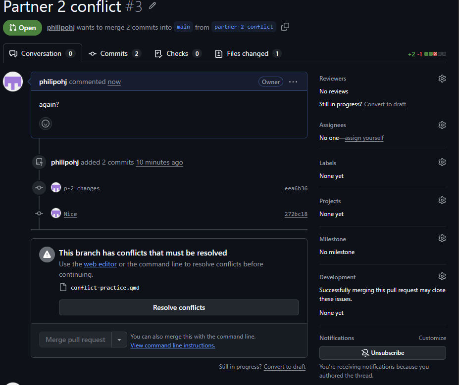
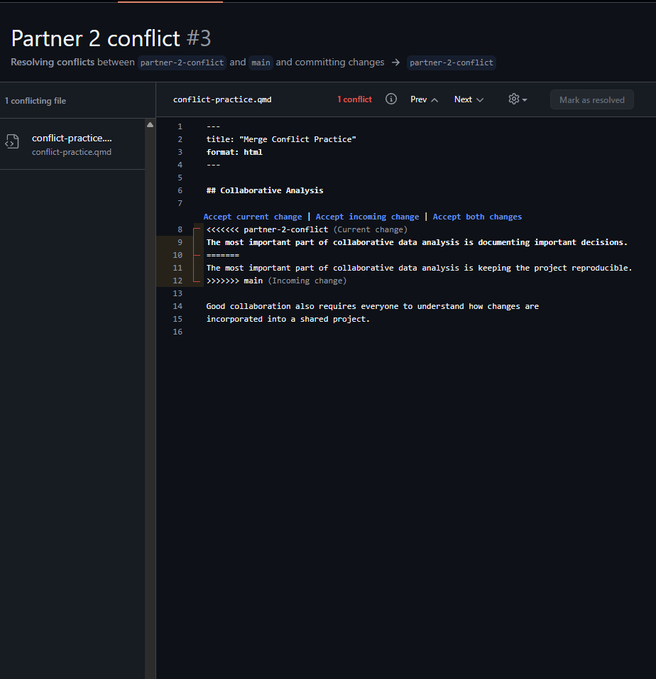
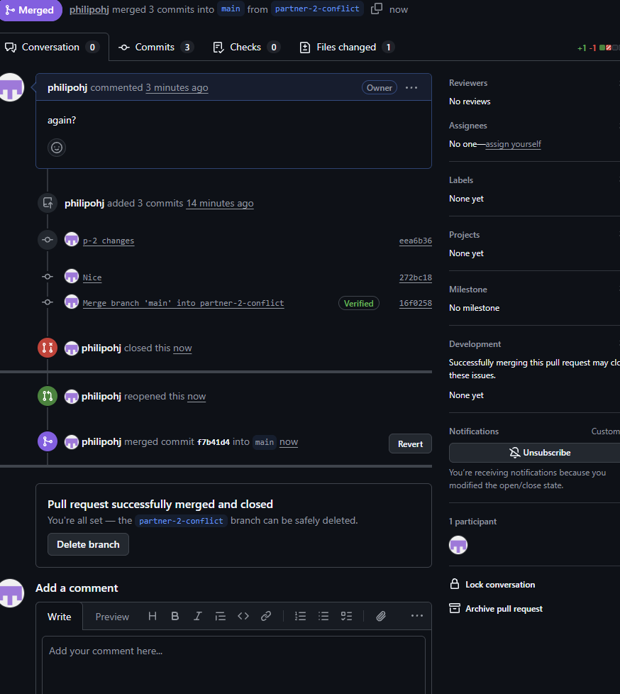

I lowkey did this by myself since I didn't want to have to coordinate with others so I am both partners.

##1.

The pull request for partner-2-conflict, after the pull request for partner-1-conflict was merged into main.

{width=100%}

##2.

The conflict markers show the sentence from partner-2-conflict and the sentence now on main (from partner-1-conflict) before anything was edited.

{width=100%}

##3. 

The pull request for partner-2-conflict after the conflict was resolved and the branch was merged into main:

{width=100%}

The final version of conflict-practice.qmd on main, containing the combined sentence and no conflict markers:

{width=100%}

##What happened

**Why did the merge conflict occur?** Both branches were created from the same commit of main, and each one changed the same line of conflict-practice.qmd in a different way. Once the pull request for partner-1-conflict was merged, main contained one new version of that line, while partner-2-conflict contained a different new version of the same original line, so the two changes overlapped.

**Why was Git unable to decide which sentence to keep automatically?** Git merges by comparing each branch with their common ancestor. It can combine changes automatically when they touch different lines, but here both branches replaced the same line relative to that ancestor. Choosing between them (or combining them) depends on what the sentence should mean, which is a judgment Git cannot make, so it stopped and asked me to decide.

**What did I keep in the final version, and why?** I kept "The most important part of collaborative data analysis is keeping the project reproducible and documenting important decisions." Both ideas are valid and complement each other: reproducibility lets others rerun the analysis, and documenting decisions explains why it was done that way. Combining them keeps both branches' contributions instead of discarding one.
